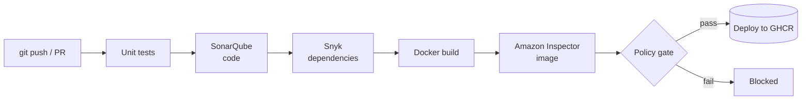

# Security scanning built into GitHub Actions

Every push is checked by three security scanners before anything is deployed:

- **SonarQube** checks the code itself (bugs, security hotspots, test coverage).
- **Snyk** checks the libraries the code uses for known vulnerabilities.
- **Amazon Inspector** checks the finished container image for known CVEs.

None of the scanners can deploy or block on its own. A single **policy gate** reads all three results and makes one decision: deploy, or stop.

[Live pipeline →](https://danielkojomegbenu.com/projects/devsecops-github-actions)

## The pipeline



| Step | What it does | Blocks the deploy when |
|---|---|---|
| 1. Push / PR | Starts the workflow in [`.github/workflows/devsecops.yml`](.github/workflows/devsecops.yml) | |
| 2. Unit tests | `pytest` with a coverage report for SonarQube | a test fails |
| 3. SonarQube | Static analysis of the code, with a quality gate | the quality gate fails |
| 4. Snyk | Checks `requirements.txt` for vulnerable packages | a high or critical issue is found |
| 5. Docker build | Builds the image but keeps it on the runner (nothing is pushed yet) | |
| 6. Amazon Inspector | Builds an SBOM of the image and scans it, signing in to AWS with OIDC (no stored keys) | a fixable high or critical CVE is found |
| 7. Policy gate | [`scripts/policy_gate.py`](scripts/policy_gate.py) applies the rules to all three results | any rule above is broken |
| 8. Deploy | Pushes the approved image to GitHub Container Registry, only from `main` | |

Pull requests run steps 1 to 7, so problems show up as a failed check before merge. Only `main` deploys.

## What's in the repo

| Path | What it is |
|---|---|
| `app/` | A tiny Flask API and its tests, just enough code to scan |
| `Dockerfile` | Slim Python image that runs as a non-root user |
| `.github/workflows/devsecops.yml` | The pipeline |
| `scripts/policy_gate.py` | The policy gate: one place for the rules |
| `sonar-project.properties` | SonarQube settings |
| `infra/main.tf` | Terraform for one IAM role GitHub can assume, allowed only `inspector-scan:ScanSbom` |

## Build it yourself

You need free accounts on [SonarQube Cloud](https://sonarcloud.io) and [Snyk](https://snyk.io), plus an AWS account.

**1. Fork or copy this repo**, and change `dkojo` to your GitHub user in `sonar-project.properties` and `infra/main.tf`.

**2. Create the AWS role** (it needs the GitHub OIDC provider in your account; [create one](https://docs.github.com/en/actions/how-tos/secure-your-work/security-harden-deployments/oidc-in-aws) first if you don't have it):

```bash
cd infra
terraform init
terraform apply
```

Copy the `role_arn` output.

**3. Set up SonarQube Cloud.** Import the repo, choose **With GitHub Actions** as the analysis method (turn off Automatic Analysis), and copy the token. Put your organization and project key in `sonar-project.properties`.

**4. Get a Snyk token** from Snyk > Account settings > Auth Token.

**5. Add three repository secrets** under Settings > Secrets and variables > Actions:

| Secret | Value |
|---|---|
| `SONAR_TOKEN` | from step 3 |
| `SNYK_TOKEN` | from step 4 |
| `AWS_ROLE_ARN` | from step 2 |

**6. Push to `main`** and watch the run in the Actions tab. The run summary shows the Inspector findings and the policy gate table, and the approved image appears under the repo's **Packages**.

## See the gate block a release

Add a library with known vulnerabilities on a branch and open a pull request:

```bash
git switch -c demo/vulnerable-dependency
echo "requests==2.19.0" >> app/requirements.txt
git commit -am "Add an old requests version"
git push -u origin demo/vulnerable-dependency
```

Snyk reports the issues, the policy gate fails, and the pull request check turns red. Nothing is deployed.

## Cost

SonarQube Cloud and Snyk are free for public repos. GHCR is free for public images. Each Amazon Inspector SBOM scan costs a few cents. The IAM role costs nothing, and `terraform destroy` removes it.
